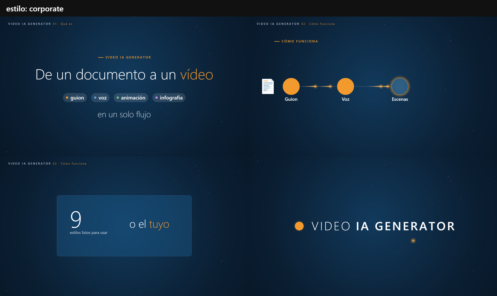
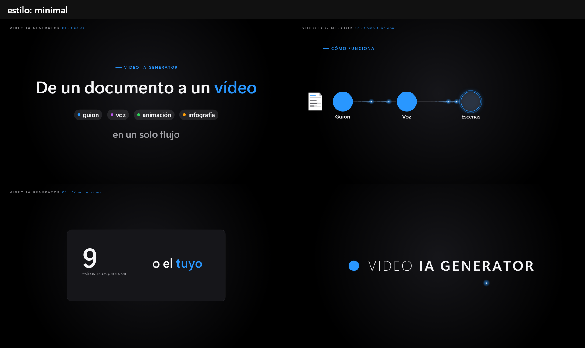
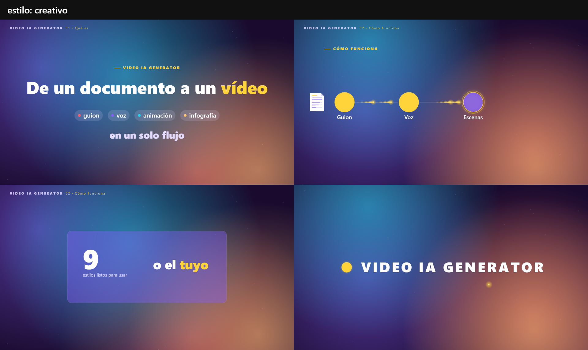
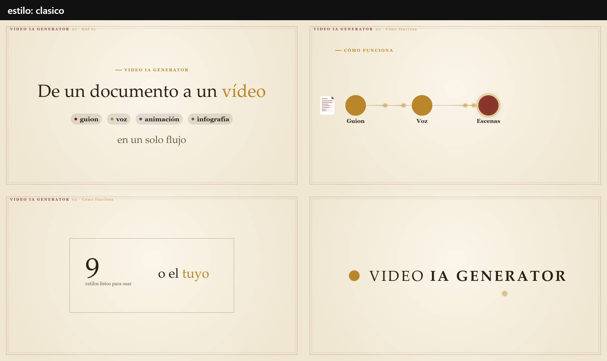
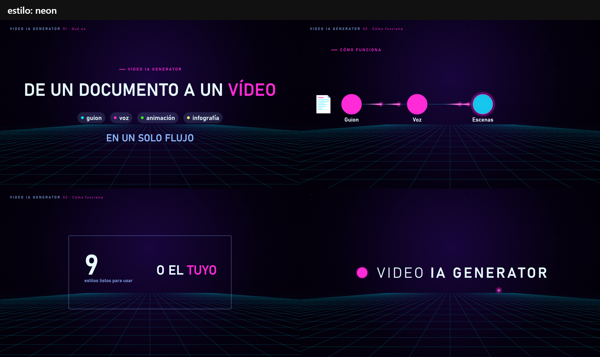
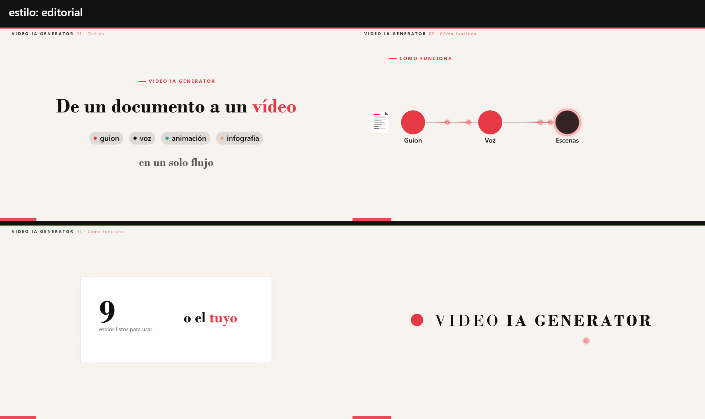
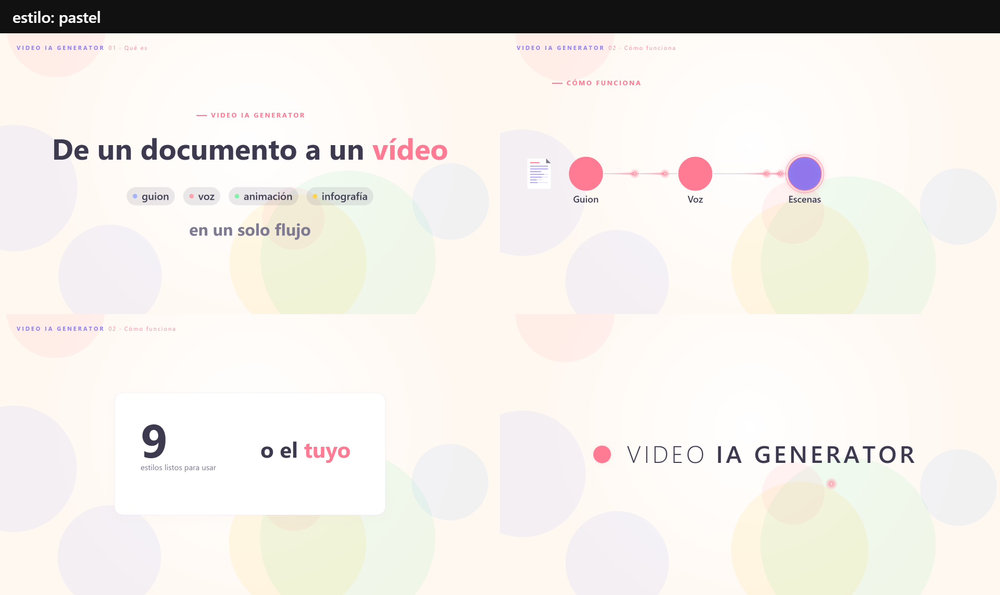
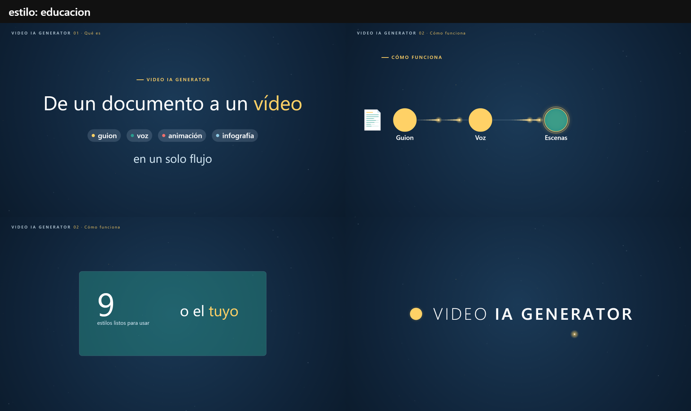
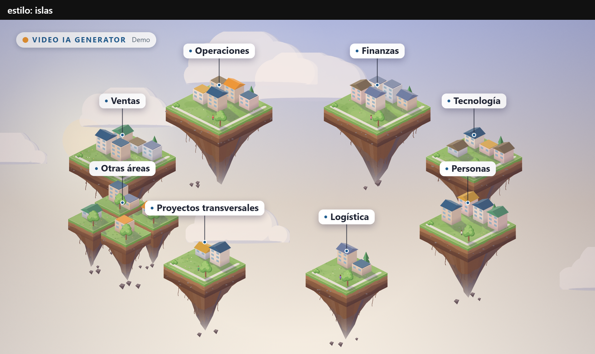

# Estilos

Un estilo es **datos**: `styles/<nombre>/theme.json` (paleta, tipografía, forma, fondo animado, brillo). El kit base (`styles/_base/kit.js`) lee esos tokens al dibujar, así que **la misma escena se ve en cualquier estilo**. Cada estilo tiene además un `kit.js` con 1–3 componentes propios y un `estilo.md` con sus reglas.

Probar un estilo con un vídeo existente sin tocarlo: `npm run stills -- videos/<slug> <seg> --stills 8 --style neon`.

## Galería

Las imágenes son la demo (`videos/demo/`) renderizada con cada estilo (`npm run style:preview -- all`).

| Estilo | Tono | Va bien para | Componentes propios |
|---|---|---|---|
| **corporate**  | ejecutivo, sobrio | estrategia, arquitectura, cifras, comité | `chapterRail`, `source` |
| **minimal**  | premium, limpio | lanzamientos, una idea fuerte, visión | `hairline`, `gradientWord`, `spotlight` |
| **creativo**  | atrevido, enérgico | marketing, redes, eventos, cultura | `sticker`, `squiggle`, `burst` |
| **clasico**  | elegante, institucional | historia, aniversarios, informes anuales | `ornament`, `dropCap`, `chapterMark`, `vignette` |
| **neon**  | futurista, técnico | ciberseguridad, IA y datos, demos | `glowText`, `hudFrame`, `glitch`, `typeLine` |
| **editorial**  | periodístico, con criterio | análisis, tendencias, datos | `bigNumeral`, `pullQuote`, `rubric`, `columnRule` |
| **pastel**  | cercano, didáctico | formación, onboarding, RR. HH. | `bubble`, `stepBadge`, `buddy` |
| **educacion**  | didáctico, motivador | clases, repaso, ciencia, filosofía | `fisica.js` (`formula`, `planet`, `quad`…), `filosofia.js` (`term`, `examCard`, `triad`…) |
| **islas**  | narrativo, wow | adopción, mapas de organización, ecosistemas | motor isométrico `engine/iso.js` + mundo `islas.js` (solo 16:9) |

## Crear un estilo

```bash
npm run new-style                       # asistente: nombre, base, 3 colores, fuentes, forma, fondo, brillo
```

O de forma automática (lo que hace la skill `crear-estilo` a partir de una descripción, una guía de marca o una web):

```bash
npm run new-style -- --yes --name marca-x --label "Marca X" --from minimal --mode dark \
  --bg "#0f1720" --primary "#2563eb" --accent "#f59e0b" --display '"Segoe UI", Arial, sans-serif' \
  --stage mesh --panel glass --radius 20 --head-weight 600 --glow 1 --tone "moderno, claro" --best-for "producto,ventas"
```

Solo se piden tres colores: el resto (fondos secundarios, texto, texto suave, líneas, papel, series de gráficos) se deriva, y se comprueba el contraste. Al terminar se renderiza `styles/marca-x/preview.png`.

## Esquema de `theme.json`

```jsonc
{
  "name": "marca-x", "label": "Marca X", "description": "…", "tone": "…", "bestFor": ["…"],
  "mode": "dark",                                   // dark | light
  "colors": {
    "bg": "#…", "bg2": "#…", "deep": "#…",          // fondo, fondo de luz/paneles, viñeta y fundidos
    "primary": "#…", "accent": "#…", "accentHi": "#…",
    "text": "#…", "soft": "#…", "line": "rgba(…)",  // texto principal, secundario, líneas
    "paper": "#…", "paper2": "#…", "ink": "#…",     // escenario de día (capturas) y su tinta
    "ok": "#…", "bad": "#…", "warn": "#…",
    "series": ["#…", "#…", "#…", "#…", "#…"]        // gráficos, píldoras, pasos
  },
  "fonts": { "display": "<pila CSS>", "body": "<pila CSS>", "mono": "<pila CSS>",
             "files": [{ "family": "Mi Fuente", "src": "fonts/mi-fuente.woff2", "weight": 400 }] },
  "type":  { "headWeight": 300, "textWeight": 300, "labelWeight": 600, "headCase": "none" },   // none | upper | lower
  "shape": { "radius": 18, "panel": "glass", "lineWidth": 2 },     // glass | solid | outline | card
  "stage": { "kind": "night", "grid": 1, "motes": 1 },             // night | clean | mesh | paper | grid | blocks | blobs
  "motion": { "glow": 1, "energy": 1 }                             // brillo (0 plano … 2 neón) e intensidad de pulsos
}
```

## Reglas para escribir escenas que sirvan a cualquier estilo

- Importa del kit del estilo (`styles/<estilo>/kit.js`) o del base (`styles/_base/kit.js`).
- Colores con tokens: `T.text`, `T.soft`, `T.accent`, `T.primary`, `T.series[i]`, `ra('accent', 0.4)` para transparencias.
- Fuentes con `T.fontDisplay` / `T.fontBody`; pesos con `T.wHead` / `T.wLabel`.
- Tamaño con `W` y `H`; nada de 1920/1080 fijos.
- `isLight()` si algo debe cambiar entre fondos claros y oscuros.
